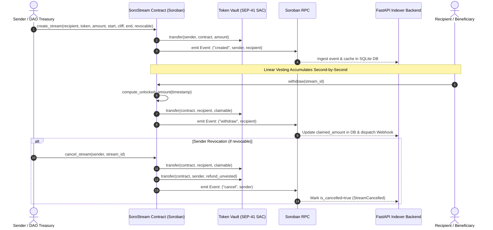

# SoroStream 🌊

> **Trustless, per-second linear asset streaming and cliff vesting protocol for Soroban Asset Contracts (SAC) on the Stellar Network.**

[](https://github.com/HassanKorey/SoroStream-app/actions)
[](LICENSE)
[](https://stellar.expert/explorer/testnet/contract/CA4L7T6R74G3T5F5V7V7RWWUHE2J76Y4WJ3L7C2WJ3L7C2WJ3L7C2WJ3)
[](https://soroban.stellar.org)

📖 **Documentation Portal**: [https://HassanKorey.github.io/SoroStream-app](https://HassanKorey.github.io/SoroStream-app)  
🚀 **Live Web3 Application**: [https://soro-stream.vercel.app](https://soro-stream.vercel.app)

---

## 🌟 Overview

**SoroStream** is a native, trustless asset streaming and vesting escrow protocol built on **Stellar** smart contracts (Soroban). It enables DAOs, corporate treasuries, Web3 founders, and grant allocators to lock tokens (XLM, USDC, or custom SEP-41 Soroban Asset Contracts) and stream them continuously to recipients second-by-second over customizable schedules with optional cliff milestones and revocation controls.

### Key Highlights
- **Sub-Second Precision**: Tokens unlock linearly every ledger second with zero gas state updates required.
- **Cliff Vesting Protection**: Guarantee lockups until cliff milestones are reached.
- **Atomic Batch Creation**: Onboard entire rosters or DAO distributions in a single transaction.
- **BUX-Inspired Glassmorphic UI**: High-contrast dark canvas (`#090D16`), vibrant emerald accents (`#10B981`), Bento Grid metric layouts, and live per-second tickers.
- **Multi-Token Verification**: Native support for Soroban Asset Contracts conforming to SEP-41.
- **Security-First**: Formally verified against cliff bypass, double-withdraw race conditions, and unauthorized cancellations.

---

## 👥 Maintainer Governance

| Name | Role | GitHub | Contact |
| :--- | :--- | :--- | :--- |
| Hassan Akorede (EDUN) | Lead Architect | [@HassanKorey](https://github.com/HassanKorey) | Telegram: `@HassanKorey` |
| Co-Maintainer | Smart Contract Reviewer | [@CoMaintainer](https://github.com/CoMaintainer) | Discord: `comaintainer#0001` |

---

## 📍 Deployed Contracts & Explorer

| Contract | Network | Address & Explorer Link |
| :--- | :--- | :--- |
| `vesting_stream` | Stellar Testnet | [`CA4L7T6R74G3T5F5V7V7RWWUHE2J76Y4WJ3L7C2WJ3L7C2WJ3L7C2WJ3`](https://stellar.expert/explorer/testnet/contract/CA4L7T6R74G3T5F5V7V7RWWUHE2J76Y4WJ3L7C2WJ3L7C2WJ3L7C2WJ3) |

- **Compiled WASM SHA-256 Hash**: `744f4b889771e3e8581093d0e796656686e94c30aefcbffd646fed848fe4c25d`

---

## 📐 Protocol Architecture & Sequence Flow



---

## ⚡ Mathematical Specification

The smart contract calculates unlocked tokens dynamically on invocation without needing periodic cron jobs or per-second storage writes. Let $t$ be the current ledger timestamp (`env.ledger().timestamp()`):

$$\text{Unlocked}(t) = \begin{cases} 
0 & \text{if } t < t_{\text{cliff}} \\
A_{\text{total}} & \text{if } t \ge t_{\text{end}} \\
\left\lfloor \frac{A_{\text{total}} \times (t - t_{\text{start}})}{t_{\text{end}} - t_{\text{start}}} \right\rfloor & \text{otherwise}
\end{cases}$$

$$\text{Claimable}(t) = \text{Unlocked}(t) - A_{\text{claimed}}$$

---

## 🚀 Quick Start Guide

### 1. Smart Contracts (Rust)
```bash
cd contracts/vesting_stream
cargo test
cargo clippy --all-targets -- -D warnings
```

### 2. Backend Indexer (Python)
```bash
cd backend
python3 -m venv .venv
source .venv/bin/activate
pip install -r requirements.txt pytest httpx
uvicorn app.main:app --reload --port 8000
pytest
```
Interactive API documentation: `http://localhost:8000/docs`

### 3. TypeScript SDK
```bash
cd sdk
npm install
npm run build
npm test
```

### 4. Frontend dApp (Next.js)
```bash
cd frontend
npm install
npm run build
npm run dev
```

### 5. Testnet Deployment
Deploy to Stellar Testnet and auto-fund via Friendbot:
```bash
./scripts/deploy_testnet.sh
```

---

## 👥 Contributors

Thanks to everyone contributing to SoroStream!

<a href="https://github.com/HassanKorey/SoroStream-app/graphs/contributors">
  
</a>

---

## 📄 License

MIT License. See [LICENSE](LICENSE) for details.
