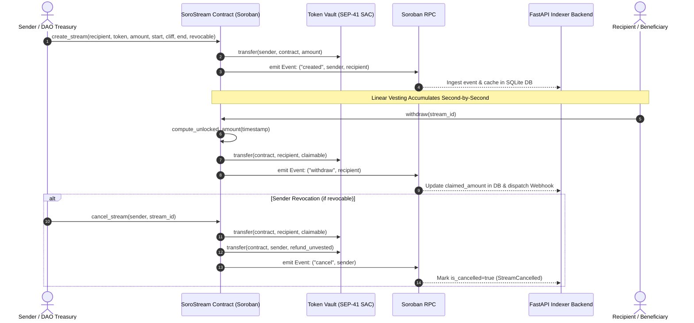

# Protocol Architecture & Specifications

SoroStream is designed for minimal gas consumption, absolute deterministic accounting, and high-performance client synchronization on the Stellar network.

---

## Architecture Sequence Diagram

The following sequence diagram outlines the complete lifecycle of a streaming escrow from stream creation to per-second withdrawal and optional sender revocation:



---

## Component Topology

```mermaid
graph TD
    A["Sender / DAO Treasury"] -->|create_stream / batch| B["SoroStream Soroban Contract"]
    B -->|Escrows Tokens| C["SAC Token Vault (SEP-41)"]
    D["Recipient / Beneficiary"] -->|withdraw() claimable| B
    B -->|Transfers unlocked tokens| D
    B -->|Emits Events (created, withdraw, cancel)| E["Soroban RPC Node"]
    E -->|Real-time Poll & Sync| F["FastAPI Indexer Backend"]
    F -->|SQLite Cache & Webhooks| G["Next.js Web3 Dashboard"]
    H["TypeScript Client SDK (@sorostream/sdk)"] -->|Math & RPC Calls| G
```

---

## Mathematical Specification

Rather than updating balances on every ledger second, SoroStream computes available tokens dynamically upon invocation using on-chain ledger timestamps:

Let:
- $t$: Current ledger timestamp (`env.ledger().timestamp()`)
- $t_{\text{start}}$: Stream start timestamp
- $t_{\text{cliff}}$: Cliff threshold timestamp
- $t_{\text{end}}$: Stream completion timestamp
- $A_{\text{total}}$: Total tokens committed to the stream
- $A_{\text{claimed}}$: Cumulative tokens already withdrawn

### Dynamic Unlock Formula

$$\text{Unlocked}(t) = \begin{cases} 
0 & \text{if } t < t_{\text{cliff}} \\
A_{\text{total}} & \text{if } t \ge t_{\text{end}} \\
\left\lfloor \frac{A_{\text{total}} \times (t - t_{\text{start}})}{t_{\text{end}} - t_{\text{start}}} \right\rfloor & \text{otherwise}
\end{cases}$$

### Claimable Delta

$$\text{Claimable}(t) = \max(0, \text{Unlocked}(t) - A_{\text{claimed}})$$

---

## Security Invariants & Attack Mitigations

| Attack Vector | Vulnerability Precondition | Protocol Mitigation |
|---|---|---|
| **Cliff Bypass** | Beneficiary calls `withdraw()` before $t < t_{\text{cliff}}$ | Smart contract enforces $t < t_{\text{cliff}} \implies \text{Unlocked} = 0$; rejects with `Error::NothingToWithdraw` |
| **Double-Withdrawal Race** | Repeated rapid invocations to drain unearned funds | Mutable state update precedes token transfer; subsequent calls find $\text{Claimable} = 0$ |
| **Unauthorized Revocation** | Third-party attacker calls `cancel_stream()` | Contract verifies `sender.require_auth()` and checks `record.sender == sender` |
| **Immutable Stream Cancellation** | Sender attempts to revoke non-revocable escrow | Contract rejects with `Error::StreamNotRevocable` if `record.revocable == false` |
| **Double-Cancellation Attack** | Repeated cancel calls to duplicate refund payouts | Contract flags `record.is_cancelled = true` on initial call; rejects secondary calls with `Error::StreamAlreadyCancelled` |
| **Integer Underflow / Time Warp** | Corrupted timestamps with $t_{\text{start}} > t_{\text{cliff}}$ | Enforced invariant: $t_{\text{start}} \le t_{\text{cliff}} < t_{\text{end}}$ and $A_{\text{total}} > 0$ |
